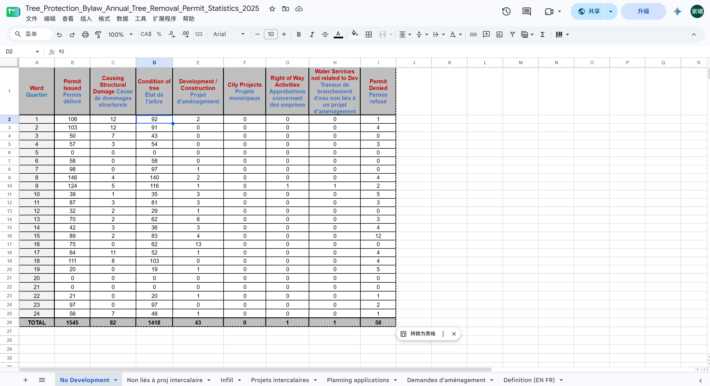
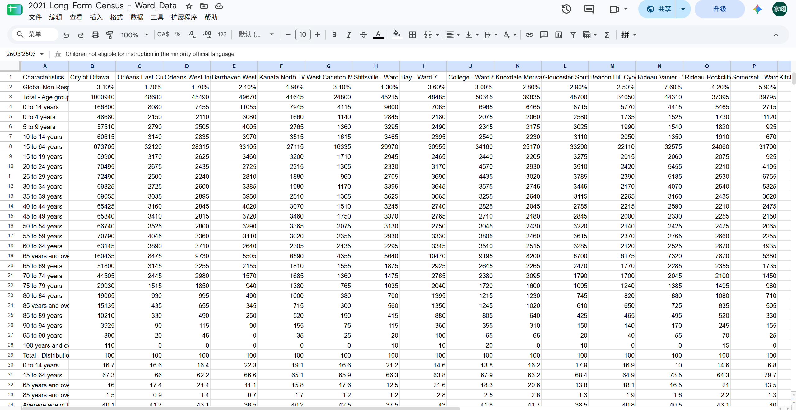

**01/11/2026**<br>
**MPAD 2003 Introductory Data Storytelling**<br>
**Jiayi Shi**<br>
**Presented to Jean-Sébastien Marier**<br>

# Deliverable 2: Exploratory Data Analysis (EDA)

Use one hashtag symbol (`#`) to create a level 1 heading like this one.

## Foreword

For this assignment, you must clean and analyze the dataset from Deliverable 1, create exploratory charts/visualizations, and identify a potential story. Your assignment must clearly detail your process. You are expected to write about 1,000-1,200 words, and to include several screen captures showing the different steps you went through. Your assignment must be written with the Markdown format and submitted on GitHub.

I have been assigning different versions of this project to my digital journalism and data storytelling students for a few years now. Its structure was inspired by the main sections/chapters of [*The Data Journalism Handbook*](https://datajournalism.com/read/handbook/one/). This version was further inspired by the [Key Capabilities in Data Science](https://extendedlearning.ubc.ca/programs/key-capabilities-data-science) program offered by the University of British Columbia (UBC).

**Here are some useful resources for this assignment:**

* [GitHub's *Basic writing and formatting syntax* page](https://docs.github.com/en/get-started/writing-on-github/getting-started-with-writing-and-formatting-on-github/basic-writing-and-formatting-syntax)
* [The template repository for this assignment in case you delete something by mistake](https://github.com/jsmarier/jou4100_jou4500_mpad2003_project2_template)

Did you notice how to create a hyperlink? In Markdown, we put the clickable text between square brackets and the actual URL between parentheses.

And to create an unordered list, we simply put a star (`*`) before each item.

Use two hashtag symbols (`##`) to create a level 2 heading like this one.

To include a screen capture, use the sample code below. Your images should be saved in the same folder as your `.md` file.

<br>
*Figure 1: The "Import file" prompt on Google Sheets.*

**Here are examples of functions and lines of code put in grey boxes:**

1. If you name a function, put it between "angled" quotation marks like this: `IMPORTHTML`.
1. If you want to include the entire line of code, do the same thing, albeit with your entire code: `=IMPORTHTML("https://en.wikipedia.org/wiki/China"; "table", 5)`.
1. Alternatively, you can put your code in an independent box using the template below:

``` r
=IMPORTHTML("https://en.wikipedia.org/wiki/China"; "table", 5)
```
This also shows how to create an ordered list. Simply put `1.` before each item.
## 1. Getting Data
Seeing a tree been cut at a construction site led me to Ottawa’s Tree Protection By-law and forced me to consider whether it is fair across electoral districts with different income levels. To investigate this question, I will analyze the [City of Ottawa’s  2025 Tree Protection Bylaw Annual Tree Removal Permit Statistics](https://open.ottawa.ca/documents/02bc1e9429fa489a9244b94c4efed4ba/about) to serve as data on tree felling. Also, I will analyze the income through [2021 Long Form Census - Ward Data](https://open.ottawa.ca/datasets/ottawa::2021-long-form-census-ward-data/about) which is also from the City of Ottawa. I put both sheet into Google Sheet, “[Tree Protection Bylaw Annual Tree Removal Permit Statistics 2025](https://docs.google.com/spreadsheets/d/1UtgN2_GMaAMOpVO0U_g64pcfHBgJEOwHV7A786Jj0sY/edit?gid=741959056#gid=741959056) and “[2021_Long_Form_Census_-_Ward_Data](https://docs.google.com/spreadsheets/d/1o5NkLEa9UJde59UErPtm6urUZeb2lH7aBXYFCZyP_lQ/edit?gid=1537556427#gid=1537556427)”. To mention that the "Planning applications" sub-table in the first table will not be used. Due to the lack of latest census data, the second sheet is based on 2021 census as it lacks data on rejections. Overall, the table structure is clear, and there are no obvious instances of missing data, and all data is discrete variables, and records the number of permits issued in column B. After seeing the data, I have a question, why is there no refusion under permit issued. There are 26 columns and 2603 rows on the second table. The table contains a large amount of data, making it difficult to read. However, for this study, I will only use the data from rows 90 to 105. Same, all data from this sheet is discrete variables. It compiled data of numbers that have total income between $10,000 and $19,999 in row 94 and $20,000 to $29,999 in row 95.
<br>
*Figure 1: A screenshot of 2025 Tree Protection Bylaw Annual Tree Removal Permit Statistics*
<br>
*Figure 2: A screenshot of 2021 Long Form Census - Ward Data*

## 2. Understanding Data

### 2.1. VIMO Analysis

Use three hashtag symbols (`###`) to create a level 3 heading like this one. Please follow this template when it comes to level 1 and level 2 headings. However, you can use level 3 headings as you see fit.

Insert text here.

Support your claims by citing relevant sources. Please follow [APA guidelines for in-text citations](https://apastyle.apa.org/style-grammar-guidelines/citations).

**For example:**

As seen in Bounegru & Gray (2011), a data visualization should be clear...

### 2.2. Cleaning Data

Insert text here.

### 2.3. Analyzing Data

Insert text here.

**This section should include a screen capture of your pivot table, like so:**

<br>
*Figure 2: This pivot table shows...*

**This section should also include a screen capture of your exploratory chart, like so:**

<br>
*Figure 3: This exploratory chart shows...*

## 3. Delivering Data

Insert text here.

## 4. References

Include a list of your references here. Please follow [APA](https://apastyle.apa.org/style-grammar-guidelines/references) or [MLA](https://www.mla.org/MLA-Style) guidelines for references. Hanging paragraphs aren't required though.

**Here's an example:**

Bounegru, L., & Gray, J. (Eds.). (2021). *The Data Journalism Handbook 2: Towards A Critical Data Practice*. Amsterdam University Press. [https://ocul-crl.primo.exlibrisgroup.com/permalink/01OCUL_CRL/hgdufh/alma991022890087305153](https://ocul-crl.primo.exlibrisgroup.com/permalink/01OCUL_CRL/hgdufh/alma991022890087305153)
