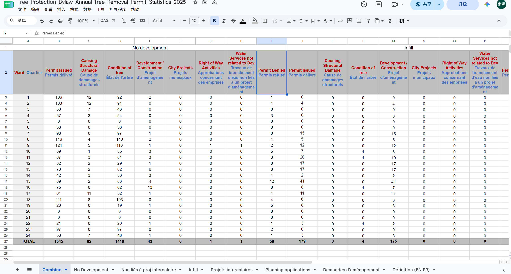
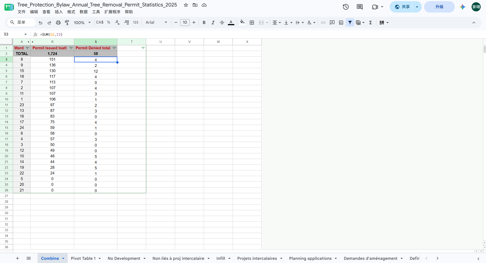
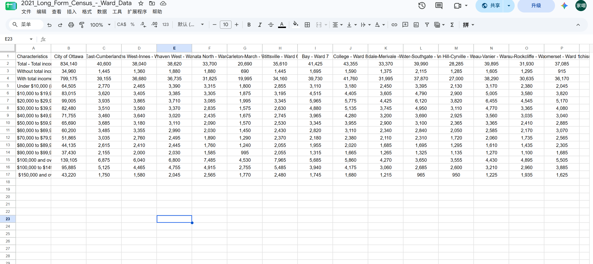
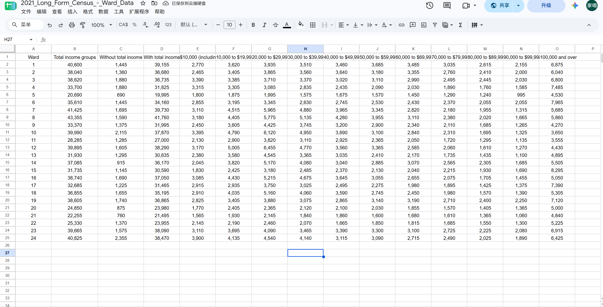
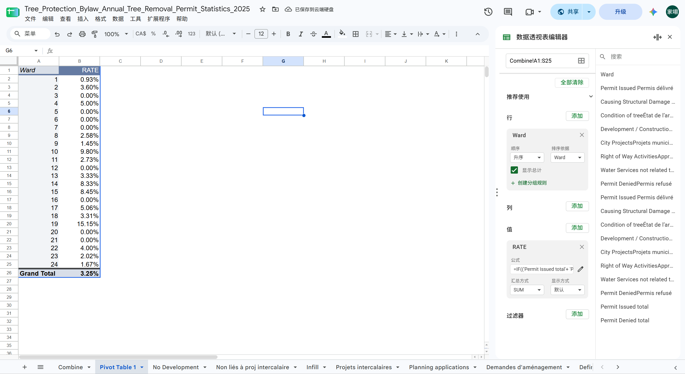
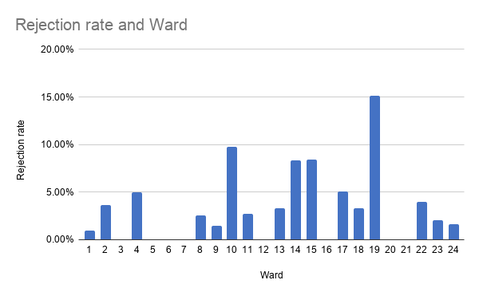
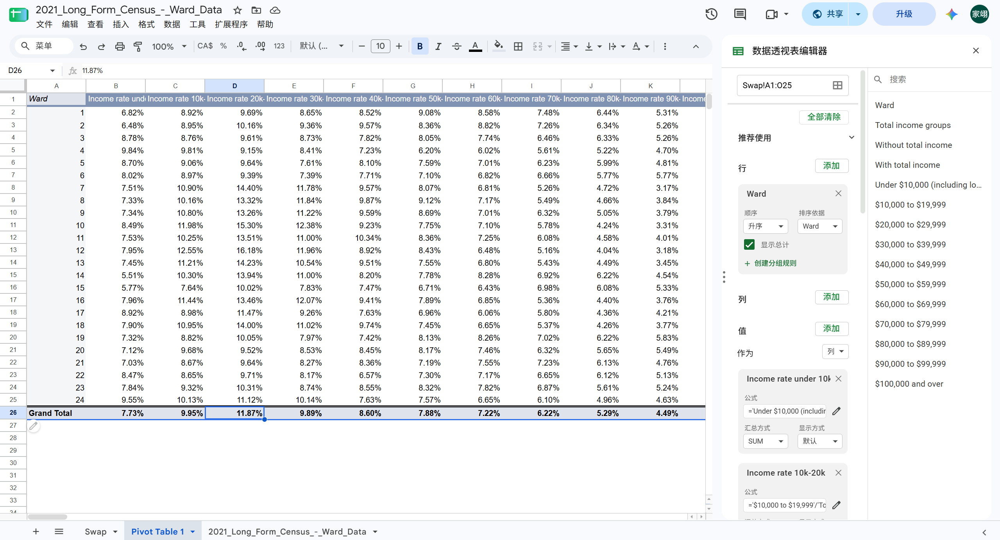
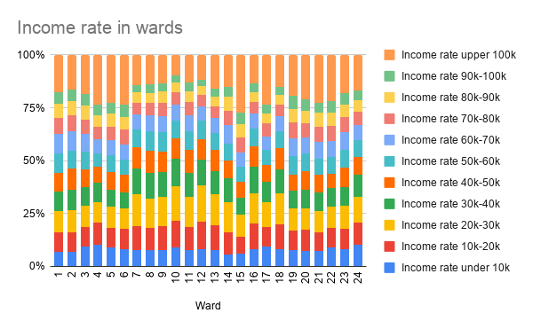

**01/11/2026**<br>
**MPAD 2003 Introductory Data Storytelling**<br>
**Jiayi Shi**<br>
**Presented to Jean-Sébastien Marier**<br>

# Deliverable 2: Exploratory Data Analysis (EDA)

Use one hashtag symbol (`#`) to create a level 1 heading like this one.

## Foreword

For this assignment, you must clean and analyze the dataset from Deliverable 1, create exploratory charts/visualizations, and identify a potential story. Your assignment must clearly detail your process. You are expected to write about 1,000-1,200 words, and to include several screen captures showing the different steps you went through. Your assignment must be written with the Markdown format and submitted on GitHub.

I have been assigning different versions of this project to my digital journalism and data storytelling students for a few years now. Its structure was inspired by the main sections/chapters of [*The Data Journalism Handbook*](https://datajournalism.com/read/handbook/one/). This version was further inspired by the [Key Capabilities in Data Science](https://extendedlearning.ubc.ca/programs/key-capabilities-data-science) program offered by the University of British Columbia (UBC).

**Here are some useful resources for this assignment:**

* [GitHub's *Basic writing and formatting syntax* page](https://docs.github.com/en/get-started/writing-on-github/getting-started-with-writing-and-formatting-on-github/basic-writing-and-formatting-syntax)
* [The template repository for this assignment in case you delete something by mistake](https://github.com/jsmarier/jou4100_jou4500_mpad2003_project2_template)

Did you notice how to create a hyperlink? In Markdown, we put the clickable text between square brackets and the actual URL between parentheses.

And to create an unordered list, we simply put a star (`*`) before each item.
## 1. Getting Data

Seeing a tree being cut down at a construction site led me to look into Ottawa’s Tree Protection By-law and drove me to question whether it is applied fairly across electoral districts with different income levels. To investigate this question, I will analyze two datasets published by the City of Ottawa: [2025 Tree Protection Bylaw Annual Tree Removal Permit Statistics](https://open.ottawa.ca/documents/02bc1e9429fa489a9244b94c4efed4ba/about) and [2021 Long Form Census – Ward Data](https://open.ottawa.ca/datasets/ottawa::2021-long-form-census-ward-data/about). hese datasets provide information on tree removal permit decisions and income distributions across wards, respectively. To open them in Google Sheets, I need to select upload under import and then click “Create new spreadsheet” and named the file by “[Tree Protection Bylaw Annual Tree Removal Permit Statistics 2025](https://docs.google.com/spreadsheets/d/1UtgN2_GMaAMOpVO0U_g64pcfHBgJEOwHV7A786Jj0sY/edit?gid=741959056#gid=741959056) and “[2021_Long_Form_Census_-_Ward_Data](https://docs.google.com/spreadsheets/d/1o5NkLEa9UJde59UErPtm6urUZeb2lH7aBXYFCZyP_lQ/edit?gid=1537556427#gid=1537556427)”. The “Planning applications” worksheet in the first workbook will not be used in this analysis. The first form contains 7 worksheet including English and French version and a worksheet containing definitions. Take the first one as an example, it has 9 columns and 26 rows. Its first column contains nominal variable data, and the rest are discrete variable data. The second sheet contains 26 columns and 2,603 rows but only rows from 90 to 105, which contains data of total income between $10,000 and $19,999 in row 94 and $20,000 to $29,999 in row 95. will be used and all data is discrete variables. After seeing the first data, I have a question, why are applications rejected in some wards but not in others? 
<br>
*Figure 1: A screenshot of 2025 Tree Protection Bylaw Annual Tree Removal Permit Statistics*<br>
<br>
*Figure 2: A screenshot of 2021 Long Form Census - Ward Data*

## 2. Understanding Data

### 2.1. VIMO Analysis


Due to the research question, both sheets need to be analyzed. For the first sheet, which is” 2025 Tree Protection Bylaw Annual Tree Removal Permit Statistics”, the rate of rejected applications in licensing decisions can be researched. In the second sheet, the income situation in each ward can be researched. Thus, one of the key points for my research is to combine both together. For the first sheets, the "Planning applications" worksheet will not be researched due to the lack of deny. The data in second sheet is complete and there isn’t any blank. When it comes to the accuracy of data measurement, the data from the first table is collected by government staff after the forestry inspector has reviewed the arborist’s report and conducted an on-site inspection if necessary. Due to its origin, the data can be considered as accurate although it can’t correctly show the realistic situation of cutting down trees, because of resident cutting trees without applying. However, there are some issues for the accuracy that should be considered in second sheet. This sheet combines data of 25% of the population, and it cannot represent everyone's income situation. For this reason, the data can only be considered as a reflection of the overall trend instead of actual situation. Since both sets of data are provided by the Canadian government, both sheet can be considered to be objective.


### 2.2. Cleaning Data

Since there are multiple worksheets to the first sheet, to clean data, the first step is to combine them into a sheet that contains all data. Upon observation, all the work sheets have the same starting rows. Thus, making a new sheet with the same starting rows as shown in Figure 3 can be considered as the best way to clean data. When organizing the relevant data, the values are summed up and compiled into a final table. Finally, by changing numbers of and arranging it from largest to smallest in the permit Issued total the data looks more prominent, as shown in Figure 4. In this step, “sum” function ```=SUM(B3,J3)``` is be used and filters have been created. For the second table, due to the large number of rows, by using the “search and replace” to check the row head and find the rows contains the data, the data I needed is found located between rows 90 and 105. Thus, remaining rows have been removed. Following this, all the data from text format are changed into numerical format to make it easier to read as shown in figure 5. Since my first table used ward numbers as columns, a swap of the rows and columns by using “TRANSPOSE” ```=TRANSPOSE('2021_Long_Form_Census_-_Ward_Data'!A1:Y17)```as shown in figure 6 can be considered as a pre-work for further research.

<br>
*Figure 3: First data cleaning version for 2025 Tree Protection Bylaw Annual Tree Removal Permit Statistics*<br>

<br>
*Figure 4: Final data cleaning version for 2025 Tree Protection Bylaw Annual Tree Removal Permit Statistics*<br>

<br>
*Figure 5: First data cleaning for 2021_Long_Form_Census_-_Ward_Data*<br>

<br>
*Figure 6: Final data cleaning for 2021_Long_Form_Census_-_Ward_Data*
### 2.3. Analyzing Data

For the data summary table for my first pivot table, ward as the row and custom calculation “Permit Denied total/ total” ```=IF(('Permit Issued total'+ 'Permit Denied total')=0, "0.00%", 'Permit Denied total'/('Permit Issued total'+ 'Permit Denied total'))```as the value has been chosen. The reason that I chose these two instead of choosing wards and “Permit Denied total” or “Permit Issued total” is because this calculation shows the proportion of tree removal permit applications that were denied in each ward. Through the data analysis table, I found that the refusion rate of ward 19 is the highest and is almost 5% higher than the second one. In my second sheet, ward as the row is still be chosen in pivoted table. In the value, the number of people in each income bracket divided by the total number of people has been picked as value. By doing that, I can easily see the proportion of residents at different income levels within each selection is highly valuable for my research. After dealing with the data, I’ve noticed that there are a particularly large number of high-income individuals (earning more than $100,000) in Ward 15. In my following research, I intend to combine the two datasets and specifically analyze whether the rejection rate in each electoral district is related to its income distribution.
<br>
*Figure 7: Image of pivot table for 2025 Tree Protection Bylaw Annual Tree Removal Permit Statistics*<br>
<br>
*Figure 8: Chart shows the rejection rate for each ward*<br>
<br>
*Figure 9: Image of pivot table for 2021_Long_Form_Census_-_Ward_Data*<br>
<br>
*Figure 10: Chart shows the income rate for each ward*
## 3. Delivering Data

For my further research, I hope I can get the exact data of the average income for each ward, which can be used in my research most easily. Otherwise, I will take the median of all income ranges and assume the maximum income will be 20k. Obviously, it will cause there will be some differences to the fact, but it will have a similar trend to help me with my study. Furthermore, to finish the story, I consider that I need a direct voice from the ward resident. Thus, I consider that I can have interviews with the residents and ask them whether they consider it fair or not. In my following research for my story background, I notice that there are residents who are dissatisfied with the rule of cutting down trees. For example, Nicole Robert can’t cut down the tree that is damaging her house because she does not get the permission (CTV News, 2026). Bider also records residents feel unsatisfied with the government due to the tree failing in his article (Bider, E. R.,2024). Bider mentioned that residents protesting the felling of trees try to cooperate with government but feel disappointed due to a lack of transparency and the inaction of the agency. I consider that it maybe also shows a injustice and can be a background message for my study.

## 4. References

Bider, E. R., & Carleton University. (2024). Imagining Tree Futures of Ottawa : Climate Change, Activism and Politics in the Urban Forest. Thesis (Ph.D.) - Carleton University, 2024.
Dyson, D. (2026, June 18). A tree in this Ottawa homeowner’s yard is destroying her home, but she can’t cut it down. CTV News Ottawa. https://www.ctvnews.ca/ottawa/article/a-tree-in-this-ottawa-homeowners-yard-is-destroying-her-home-but-she-cant-cut-it-down/

